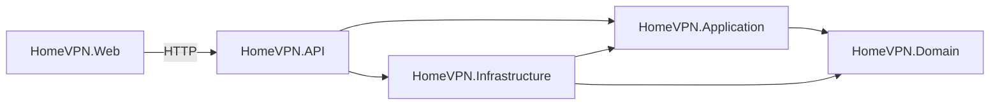

cd C:\Users\Laci\source\repos\HomeVPN# Clean Architecture

**Status:** Proposed | **Version:** 0.1

## Dependency rule
Source-code dependencies point inward. Domain depends on no application-specific framework; Application depends on Domain; Infrastructure implements Application ports; API composes dependencies and exposes HTTP endpoints. Web consumes API over HTTP.

## Responsibilities
- **Domain:** `VpnClient`, `VpnServer`, `VpnIpAddress`, invariants.
- **Application:** enrollment, revocation, queries, authorization policies, interfaces.
- **Infrastructure:** database adapter, WireGuard agent client, configuration serialization.
- **API:** controllers, request validation, authentication, DI composition.
- **Web:** user-facing views and API client.

## Recommended project references
| Project | References |
|---|---|
| Domain | None |
| Application | Domain |
| Infrastructure | Application, Domain |
| API | Application, Infrastructure |
| Web | None initially; HTTP API client |
| UnitTests | Domain, Application, Infrastructure as needed |
| IntegrationTests | API and infrastructure test hosts as needed |

## Design rules
Controllers do not invoke `wg` or write `/etc/wireguard`. Use cases do not know container paths. Secrets do not become domain log fields or ordinary response DTOs.
