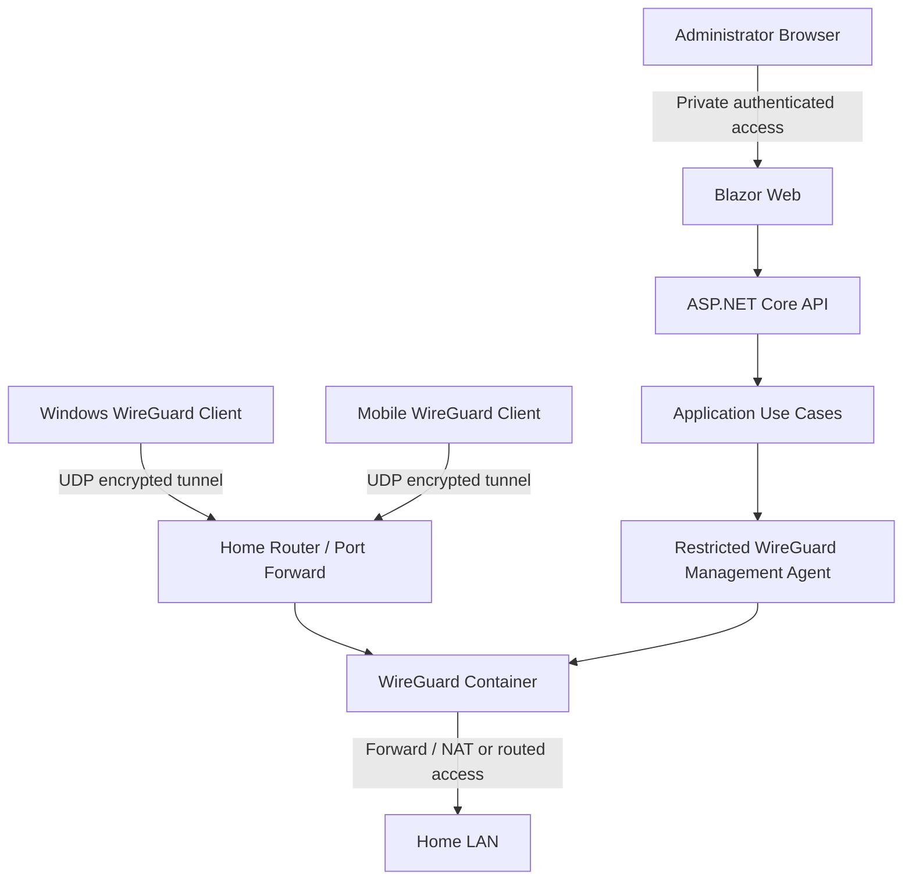

# System Architecture

**Status:** Proposed | **Version:** 0.1

## Context
Windows and mobile WireGuard clients connect through the Internet to a Linux mini PC on the home LAN. The mini PC hosts the WireGuard endpoint and the HomeVPN management stack.

## Trust boundaries
1. Internet to WireGuard UDP endpoint.
2. Administrator browser to private management UI/API.
3. Unprivileged API to privileged management agent.
4. VPN tunnel to home LAN; enforce routing and firewall policy.

## Main flows
**Connect:** client negotiates a WireGuard session, receives tunnel traffic according to its local configuration, and accesses allowed LAN addresses.  
**Enroll:** authenticated admin requests enrollment; application validates; privileged agent provisions; client config is delivered once.

## Deployment assumptions
Example only: LAN `192.168.1.0/24`, VPN `10.77.0.0/24`, server tunnel `10.77.0.1`, UDP port `51820`. Actual addresses must be discovered before deployment.

## Design constraints
Avoid mounting `/var/run/docker.sock` in the API. Do not put the API and WireGuard in a single privileged container. Separate admin and data-plane networks.
