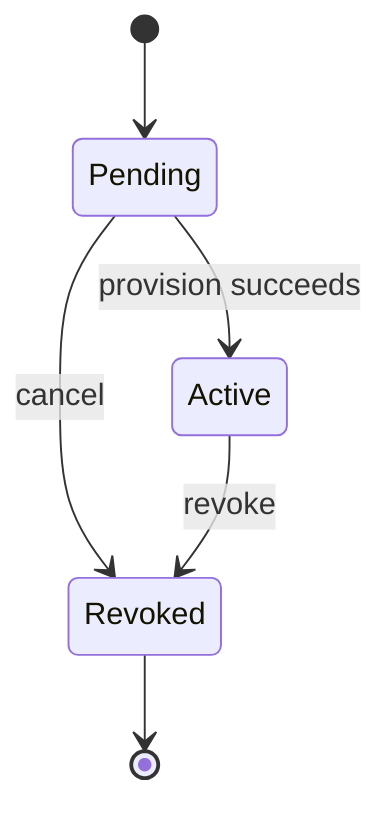

# Domain Model

**Status:** Proposed | **Version:** 0.1

## Entities
### VpnClient
- `Id`: stable identifier (UUID).
- `Name`: unique administrator-readable device label.
- `TunnelAddress`: unique VPN IPv4 address.
- `PublicKey`: WireGuard public key.
- `Status`: Pending, Active, Revoked.
- `CreatedAtUtc`, `RevokedAtUtc`: lifecycle timestamps.

### VpnServer
- `Id`, `Name`, `TunnelAddress`, `ListenPort`, `PublicKey`, `LanSubnet`.
- Server private key is **not** a regular domain entity property.

## Value objects
- `VpnIpAddress`: validated IPv4 address and subnet constraints.
- `WireGuardPublicKey`: validated public-key encoding.
- `NetworkCidr`: normalized CIDR representation.

## Invariants
1. A tunnel IP cannot belong to two active peers.
2. A public key cannot belong to two active peers.
3. Server tunnel IP is reserved.
4. Client addresses must fall within the configured tunnel subnet.
5. Revoked clients cannot be provisioned without a new enrollment flow.

## Lifecycle

## Sensitive information
Client private keys and preshared keys are secret material. Prefer one-time delivery; avoid retaining client private keys after enrollment if product requirements permit.
